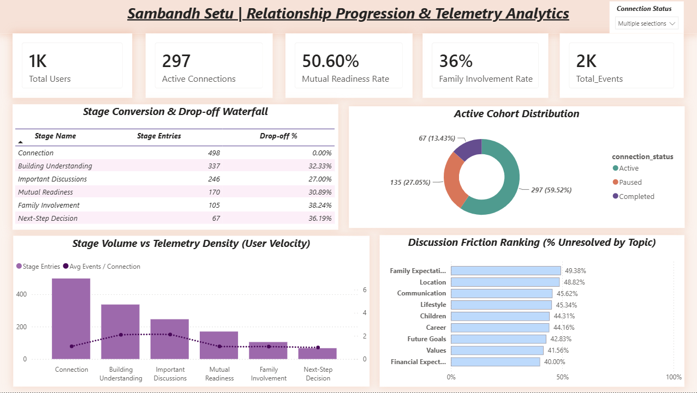

# Sambandh Setu | Relationship Progression & Telemetry Analytics

A Power BI dashboard that tracks how connections between users progress through a relationship journey, from first contact to final outcome. It shows where users drop off, which discussion topics create friction, how involved families are, and how ready both sides are to move forward.



## Business Questions Answered
- How many users and active connections does the platform have?
- At which journey stage do connections drop off the most?
- Which discussion topics are most often left unresolved (friction)?
- How involved are families, and how mutually ready are the two sides?
- How much telemetry activity does each connection generate at each stage?

## Dashboard Contents (1 page, 11 visuals)

| Visual | Type | What it shows |
|---|---|---|
| Total Users | KPI card | Size of the user base |
| Active Connections | KPI card | Connections currently active |
| Mutual Readiness Rate | KPI card | Share of connections where both sides are ready |
| Family Involvement Rate | KPI card | Share of connections with family involvement |
| Total Events | KPI card | Total journey events logged |
| Stage Conversion & Drop-off Waterfall | Table | Entries and drop-off rate per journey stage |
| Discussion Friction Ranking | Bar chart | % unresolved discussions by topic |
| Stage Volume vs Telemetry Density | Combo chart | Stage entries vs average events per connection |
| Active Cohort Distribution | Donut chart | Connections split by status |
| Connection Status | Slicer | Filters the whole page by status |

## Data Model
A star schema with 3 fact tables and 4 dimension tables, plus a dedicated `_Measures` table.

| Table | Type | Role |
|---|---|---|
| `Dim_User` | Dimension | Users |
| `Dim_Connection` | Dimension | Connection lifecycle status |
| `Dim_JourneyStage` | Dimension | Stage hierarchy and order |
| `Dim_DiscussionTopic` | Dimension | Discussion domains |
| `Fact_JourneyEvents` | Fact | Journey and telemetry events |
| `Fact_ReadinessCheck` | Fact | Readiness check logs |
| `Fact_FamilyInvolvement` | Fact | Family involvement records |
| `_Measures` | Measures | All DAX measures |

See [docs/data_model.md](docs/data_model.md) for details.

## Repository Structure
```
├── assets/                       # Dashboard screenshot
├── data/                         # Source CSV files
├── dax/measures.dax              # DAX measures for reference
├── docs/                         # Data model and project documentation
├── Sambandh_Setu_Analytics.pbix  # Power BI source file
├── LICENSE
└── README.md
```

## How to Use
1. Clone or download this repository.
2. Open `Sambandh_Setu_Analytics.pbix` in [Power BI Desktop](https://powerbi.microsoft.com/desktop/).
3. If prompted, point the data source to the CSV files in the `data/` folder (Home → Transform data → Data source settings).
4. Click **Refresh**.

## Tools Used
- Power BI Desktop
- DAX
- Power Query
- CSV data sources

## Key Insights
- **Primary Funnel Bottleneck:** Progression falls off sharply between *Mutual Readiness* (170 connections) and *Family Involvement* (105 connections), recording the peak drop-off cliff at **38.24%**
- **Friction vs Disinterest:** Telemetry velocity rises from **1.0 action/couple** at *Connection* to **~2.2 actions/couple** during *Building Understanding* and *Important Discussions* Users exit due to hard alignment decisions, not inactive usage.
- **Top Alignment Blockers:** Discussion threads face the highest deadlock in **Family Expectations (49.48%)** and **Location (48.63%)**, whereas *Finances (39.92%)* and *Values (41.47%)* reach consensus much more easily.
- **Cohort Pipeline Distribution:** **59.52%** of connections are currently Active, **27.05%** are Paused in deadlock or hiatus, and **13.43%** have reached Completed status.

---

## 🔒 Data Privacy & Source Disclaimer

> **Note on Data Provenance:**  
> The telemetry and journey dataset utilized in this project is **100% synthetic and anonymized**. It was specifically designed and generated to simulate real-world relationship progression behaviors, drop-off patterns, and conversation telemetry while strictly adhering to data privacy and protection guidelines. No real user personally identifiable information (PII) is included.

## Author
**Prerna Bharat Pande** · [LinkedIn](https://www.linkedin.com/in/prerna-pande-bb2436332) · [GitHub](https://github.com/PrernaPande9)

## License
Released under the [MIT License](LICENSE).
