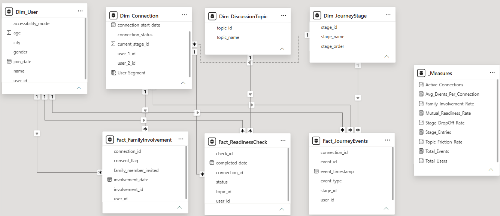

# Data Model Specification: Sambandh Setu Analytics

The semantic layer is structured around an enterprise Star Schema: dimension tables filter downstream fact tables through 1-to-Many relationships, and all core business logic is centralized inside the `_Measures` table.

---

## 1. Tables Specification

| Table Name | Table Type | Description |
| :--- | :--- | :--- |
| **`Dim_User`** | Dimension | User profile attributes and demographics. |
| **`Dim_Connection`** | Dimension | Connection pair metadata including `connection_id` and `connection_status` (Active, Paused, Completed). |
| **`Dim_JourneyStage`** | Dimension | Chronological funnel progression milestones (1 to 6) with sorting index `stage_order`. |
| **`Dim_DiscussionTopic`** | Dimension | Categorical alignment dimensions (Family Expectations, Location, Lifestyle, Finances, etc.). |
| **`Fact_ReadinessCheck`** | Fact Table | Core telemetry log recording topic readiness checks, resolution statuses (`Unresolved`, `Resolved`), and micro-actions. |
| **`Fact_JourneyEvents`** | Fact Table | Supporting telemetry stream logging timestamped interaction events across connections. |
| **`Fact_FamilyInvolvement`** | Fact Table | Escalation records specific to family intro check-ins and consent logging. |
| **`_Measures`** | Measure Container | Dedicated virtual table hosting all DAX calculations without storing physical data columns. |

---

## 2. Active Model Relationships

| From (Many: `*`) | To (One: `1`) | Foreign / Primary Key | Cross-filter Direction | Cardinality |
| :--- | :--- | :--- | :--- | :--- |
| `Fact_ReadinessCheck` | `Dim_Connection` | `connection_id` | Single | Many-to-One (*:1) |
| `Fact_ReadinessCheck` | `Dim_JourneyStage` | `stage_id` | Single | Many-to-One (*:1) |
| `Fact_ReadinessCheck` | `Dim_DiscussionTopic` | `topic_id` | Single | Many-to-One (*:1) |
| `Fact_ReadinessCheck` | `Dim_User` | `user_id` | Single | Many-to-One (*:1) |
| `Fact_JourneyEvents` | `Dim_Connection` | `connection_id` | Single | Many-to-One (*:1) |
| `Fact_JourneyEvents` | `Dim_JourneyStage` | `stage_id` | Single | Many-to-One (*:1) |
| `Fact_FamilyInvolvement` | `Dim_Connection` | `connection_id` | Single | Many-to-One (*:1) |

---

## 3. Data Model Diagram

> **Note:** To generate the image above, open **Power BI Desktop** $\rightarrow$ switch to **Model view** (left-hand sidebar) $\rightarrow$ take a clean screenshot of the schema diagram $\rightarrow$ save as `data_model.png` inside the `assets/` directory.

---

## 4. Production DAX Measures Inventory

All measures are centralized within the `_Measures` table. Complete DAX definitions and formulas are documented in [`dax/measures.dax`](../dax/measures.dax):

- **Volume & Cohorts:** `Total_Users`, `Active_Connections`, `Total_Connections`, `Stage_Entries`, `Total_Events`
- **Funnel Progression:** `Mutual_Readiness_Rate`, `Family_Involvement_Rate`, `Stage_DropOff_Rate`
- **Telemetry & Interaction Velocity:** `Avg_Events_Per_Connection`
- **Friction Diagnostics:** `Topic_Friction_Rate`